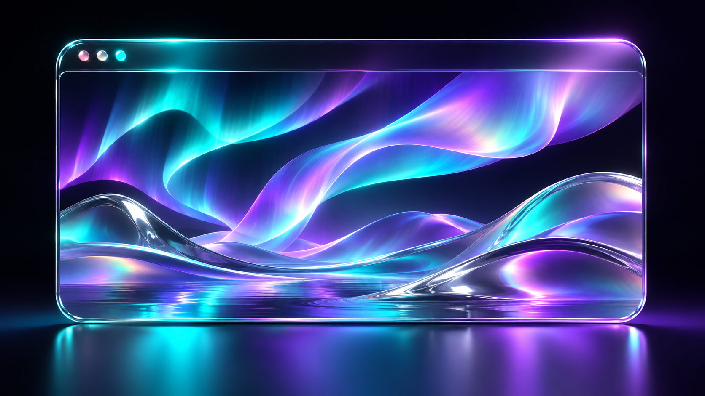
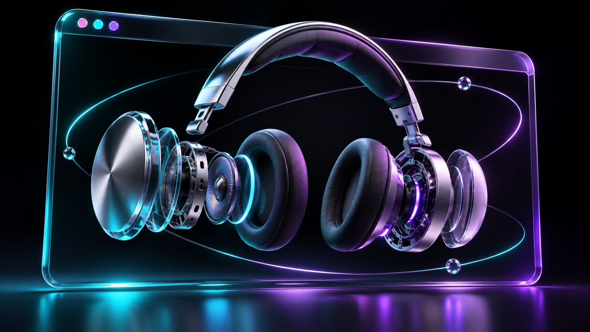
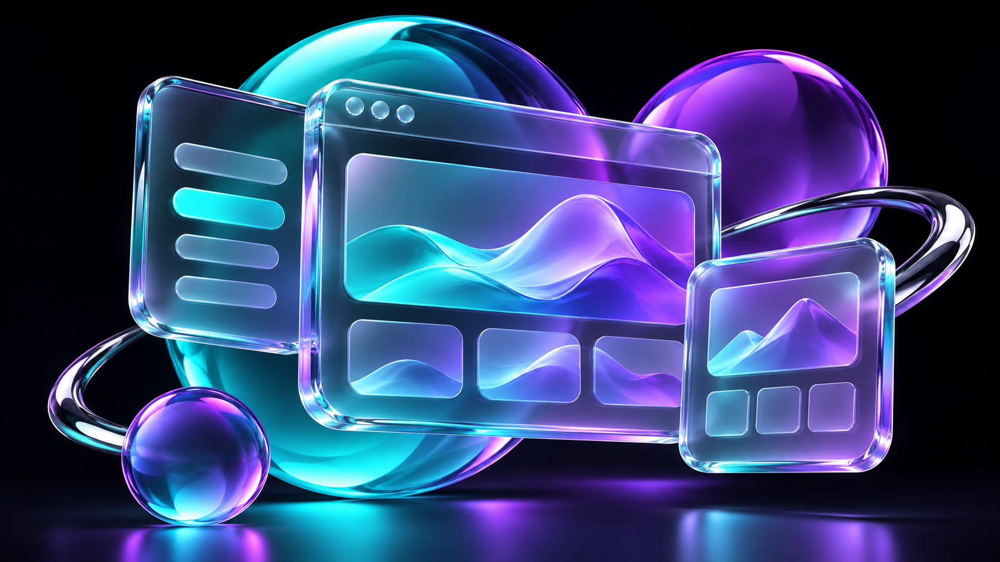
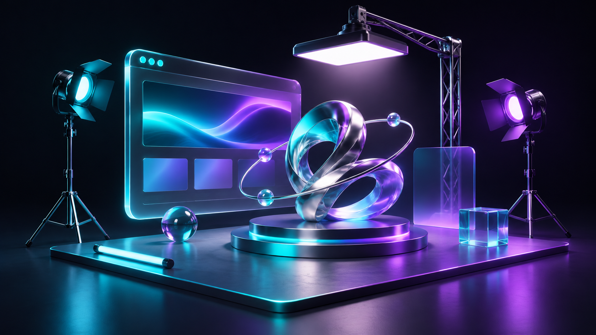
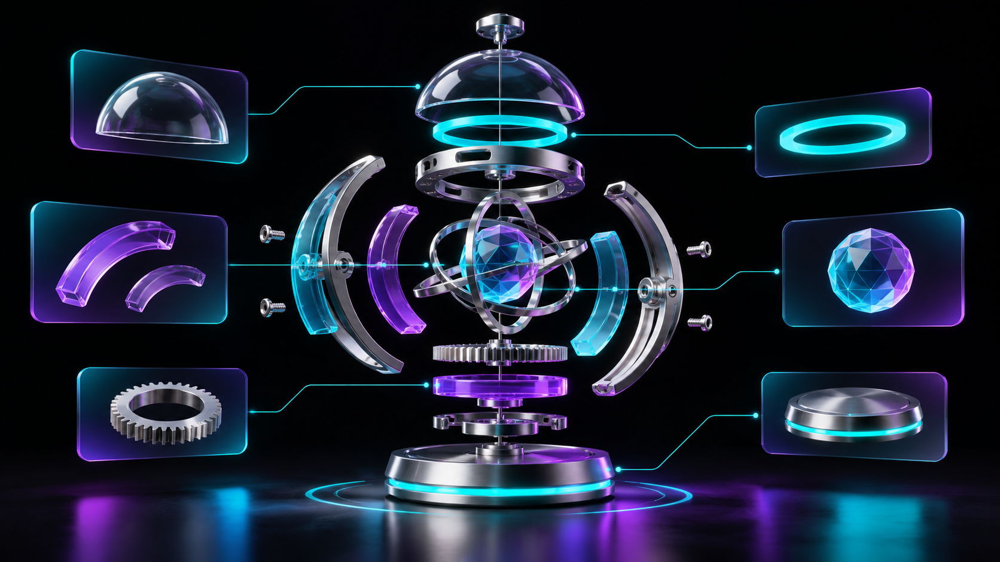
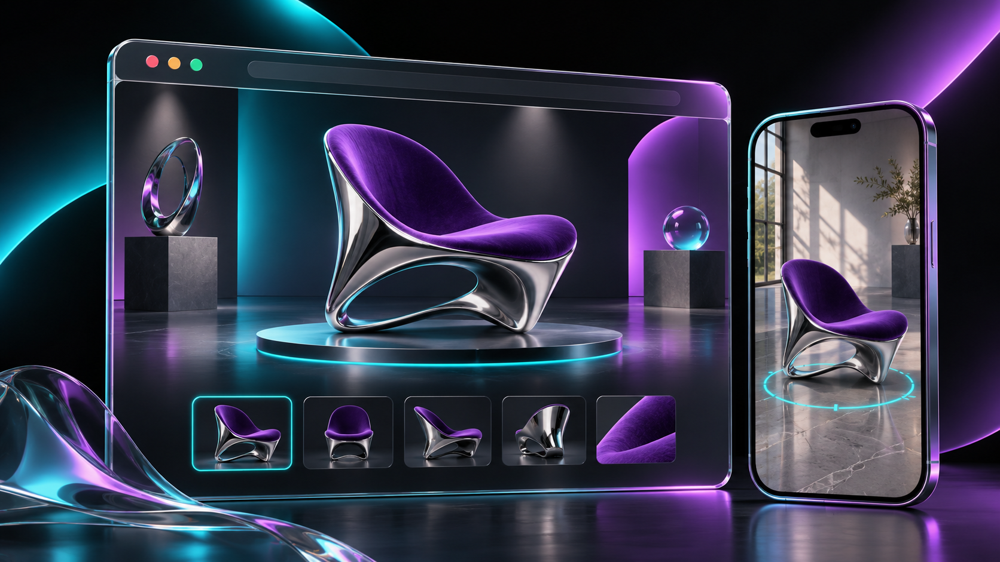
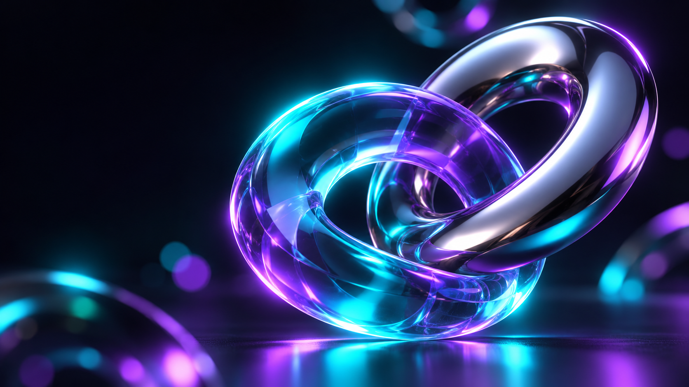
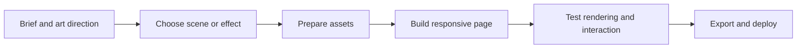

<div align="center">

# WEBMAKER PRO

### From a bold idea to a website you can explore.

**11 creative coding skills · Interactive 3D · Liquid surfaces · Cinematic motion**

[Get started](docs/INSTALLATION.md) · [Explore the skills](#explore-the-11-skills) · [Copy a recipe](docs/RECIPES.md) · [Open an issue](https://github.com/SIVARAJANnn/webmaker-pro/issues)


[](https://github.com/SIVARAJANnn/webmaker-pro/actions/workflows/validate.yml)


</div>

Build product experiences people can rotate, portfolios with atmosphere, and brand sites with depth. Webmaker Pro gives your coding assistant a coordinated design workflow and specialist skills for the pieces that make those experiences possible.

**Start with the story. Choose the effects. Ship the source.**

Includes the main Webmaker skill, ten specialist skills, pinned dependencies, model tooling, an editable product showcase, and an optional local visual Studio. These are portable agent instructions and integrations, not eleven separate npm packages.

> Gallery artwork is AI-generated concept art, not a screenshot, included 3D model or guaranteed output. Try the bundled starter to see working code. [Image prompts and provenance](docs/IMAGE_PROMPTS.md).

## Start in two steps

### 1. Install the skills in your favorite editor

```sh
git clone https://github.com/SIVARAJANnn/webmaker-pro.git
cd webmaker-pro
node scripts/install-skills.mjs --project . --target cursor
```

Replace `cursor` with `codex`, `claude` or `antigravity` to choose an installer target. Open the project in your editor and start a fresh assistant chat. The installer adds all 11 skills without overwriting custom skills.

### 2. Prepare all subpackages with one prompt

Copy the [complete installation prompt](docs/INSTALLATION.md#step-2--prepare-all-subpackages-with-one-prompt). It restores the toolkit, starter, isolated Model Viewer dependencies and pinned upstream sources, then checks readiness.

**[Follow the step-by-step guide →](docs/INSTALLATION.md)**

Requires Node 22.20+, npm and Git. On Windows PowerShell, use `npm.cmd` if needed. Discovery varies by editor version; explicitly reference an installed SKILL.md when necessary.

## What do you want to build?

| Your idea | Start with | Add when useful |
| --- | --- | --- |
| A product you can rotate and customize | Webmaker + React Three Fiber | Drei, gltfjsx, glTF Transform |
| A portfolio with an atmospheric hero | Webmaker + ShaderGradient | Liquid Glass, Liquid Logo |
| A cinematic 3D launch page | Webmaker + React Three Fiber | Drei, Postprocessing |
| An HTML product viewer | Webmaker + Model Viewer | glTF Transform |
| A 3D journey across pages | Webmaker + React Three Next | Fiber, Drei, selective effects |

[Copy complete website briefs →](docs/RECIPES.md)

## Explore the 11 skills

### The creative director

[](docs/packages/webmaker.md)

**`/webmaker` · Turn a brief into a cohesive website.** Coordinates concept, typography, layout, motion, responsiveness and visual QA so effects support the story.

[Use cases, practical notes and example prompt →](docs/packages/webmaker.md)

### Color in motion

[](docs/packages/webmaker-shadergradient.md)

**`/webmaker-shadergradient` · Create atmospheric animated backgrounds.** Adds depth and motion without requiring a bespoke 3D model or a background video.

[Use cases, practical notes and example prompt →](docs/packages/webmaker-shadergradient.md)

### A living identity

[](docs/packages/webmaker-liquidlogo.md)

**`/webmaker-liquidlogo` · Give a logo a flowing metallic finish.** Makes a brand mark a memorable focal point with shader-driven liquid highlights.

[Use cases, practical notes and example prompt →](docs/packages/webmaker-liquidlogo.md)

### Build in three dimensions

[](docs/packages/webmaker-reactthreefiber.md)

**`/webmaker-reactthreefiber` · Create interactive React 3D scenes.** Connects Three.js rendering to React components, with controllable cameras, animation and scene state.

[Use cases, practical notes and example prompt →](docs/packages/webmaker-reactthreefiber.md)

### Interfaces with depth

[](docs/packages/webmaker-liquidglassreact.md)

**`/webmaker-liquidglassreact` · Add refractive glass surfaces.** Provides a layered visual hierarchy while retaining normal interactive HTML controls.

[Use cases, practical notes and example prompt →](docs/packages/webmaker-liquidglassreact.md)

### Your scene toolkit

[](docs/packages/webmaker-drei.md)

**`/webmaker-drei` · Assemble lighting, controls and model helpers.** Reduces repeated setup for model loading, orbit controls, environment lighting and presentation.

[Use cases, practical notes and example prompt →](docs/packages/webmaker-drei.md)

### Make 3D lighter

[](docs/packages/webmaker-gltf-transform.md)

**`/webmaker-gltf-transform` · Inspect and optimize glTF and GLB assets.** Finds redundant data and helps reduce asset weight while checking geometry, materials and animation quality.

[Use cases, practical notes and example prompt →](docs/packages/webmaker-gltf-transform.md)

### Models become components

[](docs/packages/webmaker-gltfjsx.md)

**`/webmaker-gltfjsx` · Generate editable React scene components.** Turns model nodes into a component structure you can wire to React controls.

[Use cases, practical notes and example prompt →](docs/packages/webmaker-gltfjsx.md)

### A model, anywhere

[](docs/packages/webmaker-model-viewer.md)

**`/webmaker-model-viewer` · Embed a focused model viewer in HTML.** Adds a self-contained web component without requiring a full React scene architecture.

[Use cases, practical notes and example prompt →](docs/packages/webmaker-model-viewer.md)

### The cinematic finish

[](docs/packages/webmaker-react-postprocessing.md)

**`/webmaker-react-postprocessing` · Add selective rendering effects.** Directs attention and gives a scene a controlled cinematic finish.

[Use cases, practical notes and example prompt →](docs/packages/webmaker-react-postprocessing.md)

### One scene. Many pages.

[](docs/packages/webmaker-react-three-next.md)

**`/webmaker-react-three-next` · Preserve 3D across Next.js routes.** Offers a shared-canvas architecture reference for continuous motion across route changes.

[Use cases, practical notes and example prompt →](docs/packages/webmaker-react-three-next.md)

## From idea to interaction



Keep content and navigation in accessible HTML. Load expensive scenes when needed. Use static posters, reduced-motion behavior and mobile performance budgets.

## Try the included Studio

After setup, run `npm run studio` and open the printed local address. Choose Form 01, Object Study or Orbit, edit visually, try the 3D controls and export source plus a static build. AI editing uses a separately installed and authenticated Codex CLI.

Prefer code? Run `npm run dev --prefix templates/product-showcase`. Form 01 includes an on-demand viewer, material choices and a static poster.

[Studio, exports and maintenance →](docs/OPERATIONS.md)

## Inside the repository

| Path | Contents |
| --- | --- |
| `skills/` | Eleven skills, references, source snippets and attribution |
| `studio/` | Local visual editor and sample assets |
| `templates/` | Editable product showcase and registry |
| `integrations/model-viewer/` | Isolated Model Viewer profile |
| `scripts/` and `checks/` | Installation, asset preparation and validation |
| `docs/` | Illustrated guides, installation, recipes and image prompts |
| `npm-shrinkwrap.json` | Pinned toolkit dependencies |
| `sources.lock.json` | Exact upstream source revisions |

The complete distributable source and lockfiles are included. Installed dependencies, build output, local Studio sessions and full upstream Git checkouts are restored separately. Run the setup guide and `npm run sources:restore` to reconstruct the toolkit.

## Build on it

Found an issue or made a useful template? [Read the contribution guide](CONTRIBUTING.md), then open an issue or pull request. Include screenshots or a short recording for visual changes.

If Webmaker Pro helps your next project, star the repository and share what you made.

## Credits and licensing

Webmaker adapts the upstream awwwards skill by [juliobsz](https://github.com/juliobsz/skills). Specialist integrations build on the authors linked in each guide. This independently assembled toolkit does not imply upstream endorsement.

Read [third-party notices](THIRD_PARTY_NOTICES.md) and each skill's license before redistribution. Third-party material retains its original terms; no blanket license is asserted for the whole bundle. Original sample asset attribution is documented with the templates. The package remains private to npm to prevent accidental registry publication.

