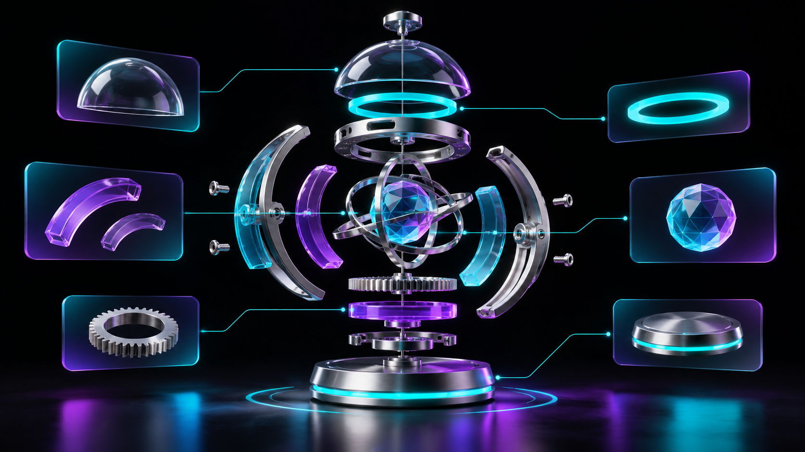

# Models become components

**`/webmaker-gltfjsx` — Generate editable React scene components.**



*AI-generated concept illustration; not a screenshot or a bundled model.*

## Where and when to use it

When a product configurator needs part-level materials, exploded views or independent animation.

## How it helps you build

Turns model nodes into a component structure you can wire to React controls.

## Try this prompt

```text
/webmaker-gltfjsx Convert my GLB into a reusable React Three Fiber component. Keep useful part names, expose finish selection and animate an exploded view with a reset control.
```

## Installation and practical notes

Install the skill using [Step 1](../INSTALLATION.md#step-1--install-the-skills-in-your-favorite-editor), then prepare the toolkit with [Step 2](../INSTALLATION.md#step-2--prepare-all-subpackages-with-one-prompt). Run the pinned toolkit CLI so its overrides apply. Inspect generated output; asset optimization can change node names.

Pair this with `/webmaker` for the surrounding page, typography and responsive layout. Verify actual rendering, keyboard interaction, reduced motion and the production build on your target devices.

[Read the skill](../../skills/webmaker-gltfjsx/SKILL.md) · [Upstream project](https://github.com/pmndrs/gltfjsx) · [All 11 skills](../../README.md#explore-the-11-skills)
