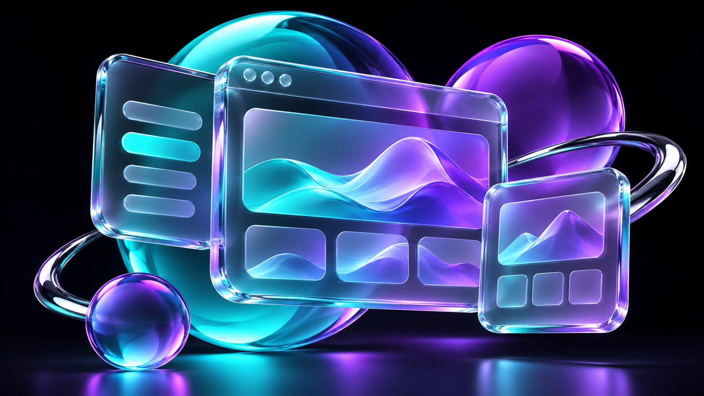

# Interfaces with depth

**`/webmaker-liquidglassreact` — Add refractive glass surfaces.**



*AI-generated concept illustration; not a screenshot or a bundled model.*

## Where and when to use it

On navigation, floating toolbars and small feature cards over visually rich backgrounds.

## How it helps you build

Provides a layered visual hierarchy while retaining normal interactive HTML controls.

## Try this prompt

```text
/webmaker-liquidglassreact Add a restrained liquid-glass navigation bar over the hero. Keep keyboard focus visible, text readable and a solid CSS fallback for unsupported browsers.
```

## Installation and practical notes

Install the skill using [Step 1](../INSTALLATION.md#step-1--install-the-skills-in-your-favorite-editor), then prepare the toolkit with [Step 2](../INSTALLATION.md#step-2--prepare-all-subpackages-with-one-prompt). Browser displacement support varies. Use sparingly and verify Safari and Firefox.

Pair this with `/webmaker` for the surrounding page, typography and responsive layout. Verify actual rendering, keyboard interaction, reduced motion and the production build on your target devices.

[Read the skill](../../skills/webmaker-liquidglassreact/SKILL.md) · [Upstream project](https://github.com/rdev/liquid-glass-react) · [All 11 skills](../../README.md#explore-the-11-skills)
